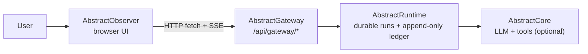

# AbstractObserver

Gateway-only observability UI (Web/PWA) for AbstractFramework runs.

What it does (implemented in `src/ui/app.tsx` + `src/lib/gateway_client.ts`):
- **Discover** workflows/bundles exposed by an AbstractGateway
- **Launch** runs, or create **automations** that the gateway runs on a schedule, when something arrives (mail, a feed item, a webhook call) or by hand (durable)
- **Observe** runs and subruns by replaying + streaming the durable **ledger** (replay-first + SSE)
- **Inspect runtime state** across active runs, generated artifacts, provider calls, and gateway audit logs
- **Control** runs via durable commands (`pause`, `resume`, `cancel`)
- (Optional) **Voice**: Read aloud (streamed sentence by sentence) and dictation in Ask, run outcomes and Automations → Discuss; Settings → Voice is the kit's shared section showing the gateway's default routes (`src/ui/observer_voice.tsx`)

## Watching entities (the entity app)

The **entity app** (memory graph + visits UI) is its own package,
[AbstractEntity](https://github.com/lpalbou/AbstractEntity)
(`npx @abstractframework/entity`, default port `3007`). The observer still
*watches* entities — the Board's entities strip reads
`GET /api/gateway/entities` + `/entities/{name}/card` — and its
"Entities ↗" links point at the entity app deployment
(`--entity-app-url`, default `http://127.0.0.1:3007`).

## Where it fits (AbstractFramework ecosystem)
AbstractObserver is one of the browser UIs in the **AbstractFramework** ecosystem:
- AbstractFramework (ecosystem entrypoint): https://github.com/lpalbou/AbstractFramework
- AbstractRuntime (durable runtime + ledger behind the gateway): https://github.com/lpalbou/abstractruntime
- AbstractCore (LLM + tools integration used by runtime/workflows): https://github.com/lpalbou/abstractcore



## Quickstart (npm)
Prereqs:
- Node.js `>=18`
- An AbstractGateway that exposes the endpoints listed in `docs/api.md`

Run the UI server:
```bash
npx --yes --package @abstractframework/observer -- abstractobserver
```

Note: the npm package is `@abstractframework/observer`, and the CLI binary is `abstractobserver`.

Open `http://localhost:3001`. Sign-in is the shared AbstractFramework
connection dialog (the same one AbstractFlow and the gateway console use):
it opens automatically when this browser has no gateway session — enter the
gateway URL (pre-filled from the server), a Gateway user id, and that
user's token. The dialog is always one click away on the header connection
badge.

In hosted mode, Observer exchanges the user token for an app-scoped Gateway
browser session and does not persist the token in browser settings. Direct
bearer-token mode remains available for local development. When Observer is
served from a non-local hostname, the server-configured Gateway URL is
authoritative; browser-supplied Gateway URL changes are rejected unless
`ABSTRACTOBSERVER_ALLOW_REMOTE_BROWSER_GATEWAY_CONFIG=1` is set behind your own
access control. If a reverse proxy rewrites `Host`, set
`ABSTRACTOBSERVER_TRUST_PROXY_HEADERS=1` only when the proxy strips
client-supplied forwarded headers.

## Install options
### Global install
```bash
npm install -g @abstractframework/observer
abstractobserver
```

### Pin a version (recommended for deployments)
```bash
npx --yes --package @abstractframework/observer@0.10.1 -- abstractobserver
```

### CLI configuration
The CLI (`bin/cli.js`) serves the built UI and mounts the app-origin Gateway
session proxy from `@abstractframework/app-server` (a runtime dependency of
this package, installed automatically).
- `--gateway-url <url>` (aliases `--gateway`, `--url`) — the Gateway this server
  signs in to and proxies `/api` to. Default: the gateway installed on this
  computer (`~/.abstractframework/gateway.json`, followed when it moves port),
  else `http://127.0.0.1:8080`.
- `--port <n>` (default `3001`) and `--host <addr>` (default `127.0.0.1`)
- `--monitor-gpu` — the optional GPU widget
- `--entity-app-url <url>` — where the entity app lives (the "Entities ↗" links)
- `--gateway-dir <dir>` — base for relative run workspace paths (local folder reveal)

Environment variables are legacy aliases below the flags: `PORT`, `HOST`,
`ABSTRACTOBSERVER_GATEWAY_URL`, `ABSTRACTGATEWAY_URL`,
`ABSTRACTOBSERVER_MONITOR_GPU`, `ABSTRACTOBSERVER_ENTITY_APP_URL`,
`ABSTRACTOBSERVER_GATEWAY_DIR`.

The gateway can also serve the Observer through itself at `/apps/observer/`
(one port and one address for the console, the API and the apps, e.g. on a
remote server): the gateway starts this server on `127.0.0.1` and relays to
it. `abstractobserver --help` lists the flags.

See `docs/configuration.md` for the full list.

## Features (UI pages)
All pages share the same gateway connection settings.

- **Board** (Mission Control, the landing page): one card per **task** — a run you started, or an automation's turn — in the lane of whatever blocks it: **Needs you** (only you can move these: the asking subrun's request with inline Approve/Reject/Answer/Resume; a run that waits on a subrun that already ended is marked **stuck** and says so), **Working** (an agent is on it: the open step, how long ago it moved, a ⚠ past the no-progress threshold you pick in the lane head), **Waiting on…** (something else must happen first: a subrun, an event, the clock), **Scheduled** (automations: next run, last run, turns, cadence), **Done** (the outcome glimpse, time, tokens, tools, artifacts). A task card shows its chain of subruns inside — each with its own words, a link to that run and a stop control for that subrun alone — and every lane head has a cancel-all for its tasks (a cancel reaches the task's parents and subruns, never an automation's schedule). The last known board paints at once on reload and refreshes behind it; the (i) carries the full task and an automation's parameters; ⧉ copies the run id.
- **Observe**: link to one run with `#run/<run_id>` (under the gateway: `/apps/observer/#run/<run_id>`; an unknown run, or one your account cannot see, is said so plainly); workflow/subworkflow navigator, the run view (a one-paragraph summary, then the steps grouped by agent cycle as collapsed cards that expand to the full prompt and answer; LLM calls / Tools / Failed filters, an All steps switch for housekeeping, search), graph, **Ask** about the run (the whole conversation is sent; a note says when the gateway's 50,000-token window left older messages out; optional voice: PTT + TTS) The **Agent** view (where a board card opens) profiles the agent — who it is, what it may use and did use, what it does, for how long, what comes after — every value complete (collapsed by size, never clipped) with copy on hover, its inputs and outputs as AbstractFlow pins with live values, its context window, run tree and spend. The **Flow** view says ongoing or finished, highlights the current node in AbstractFlow's vocabulary, and shows each node's facts on hover with copy (facts, records, the exact LLM context) and a one-click **Copy run state** for AI readers.
- **Assistant** (top bar): questions about the Observer itself, from its docs; one gateway session per conversation (**New conversation** starts fresh), no tools
- **System** (the Runtime view): Activity, Artifacts, Memory, and Logs modes for platform-level monitoring. The Artifact Explorer uses Gateway artifact envelopes and exact stats, separates Voice/Music/Sound/unclassified audio from render kinds such as Markdown/HTML/JSON, previews media inline, and links artifacts back to producing runs, ledgers, and trace/audit actions when metadata is available
- **Launch** (a modal, not a page): **+ New automation** on the Automations page opens it in Automate mode (what, including flows that run by themselves, with their own trigger preselected; when: the flow's trigger, something arriving, by hand, UTC intervals, or daily / weekly / monthly / once on your account's time zone, worded by the gateway; independent or growing context; tool approval); the header's **Launch** button opens it in Run once mode; `#launch` / `#launch/automate` deep links open it over the current page; bundle upload/reload
- **Automations**: every automation of the signed-in user, with pause/resume/run now (also while paused)/stop current/edit (task, interval, context, tools — the row's Edit opens the form at once)/archive, triggers in words ("When mail arrives in …", "When Release notes has a new item"), its runs read as a conversation (what arrived above each run, **After the run** under each answer: the note, the alert or why nothing rang, each delivery), answers to waiting runs by kind (question, tool approval, event), its folder browsable from the browser (open or download through the gateway), and Discuss (a chat, on the same page, with a fork at an occurrence: its full history, its own workspace and the automation's files read-only); legacy schedules keep their controls and can be recreated as automations (`docs/automations.md`)
- **System → Memory**: knowledge-graph (active memory) query UI (requires `POST /api/gateway/kg/query`)
- **Settings**: connection status, theme and display preferences, optional remote tool worker
- **Responsive layout**: phones, tablets and small windows get a navigation drawer, full-width lists and details with collapsible lists, bottom-sheet dialogs and touch-sized controls (`docs/getting-started.md` → "Responsive layout")
- **About** (the info button in the top bar): the shared compact About card with the AbstractObserver version, the AbstractFramework and AbstractGateway versions the connected gateway reports, links (website, source, docs, issues, feedback, contact) and the licence line

## Documentation
- Start here: `docs/getting-started.md`
- Docs index: `docs/README.md`
- FAQ: `docs/faq.md`
- Architecture (with diagrams): `docs/architecture.md`
- Configuration & deployment: `docs/configuration.md`
- API (gateway endpoints used): `docs/api.md`
- Automations (create, manage, answer, discuss): `docs/automations.md`
- Troubleshooting: `docs/troubleshooting.md`
- Development: `docs/development.md`
- Security & trust boundaries: `docs/security.md`

## Project
- Changelog: `CHANGELOG.md`
- Contributing: `CONTRIBUTING.md`
- Security policy (vulnerability reporting): `SECURITY.md`
- Acknowledgments: `ACKNOWLEDGMENTS.md`
- Code of conduct: `CODE_OF_CONDUCT.md`

## Development (from source)
```bash
npm install
npm run dev
```

Important: dev/build expects the sibling “AbstractUIC” checkout for the monitor packages (`@abstractframework/monitor-*`), which `vite.config.ts` aliases to `../abstractuic/*/src`; `@abstractframework/ui-kit` and `@abstractframework/panel-chat` are npm dependencies.
See `docs/development.md` for details.
